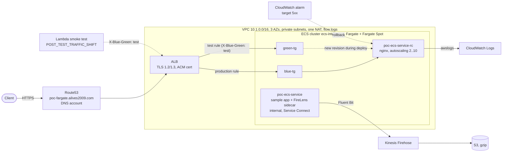
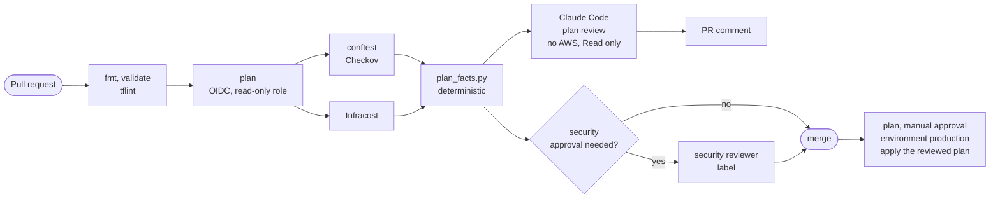
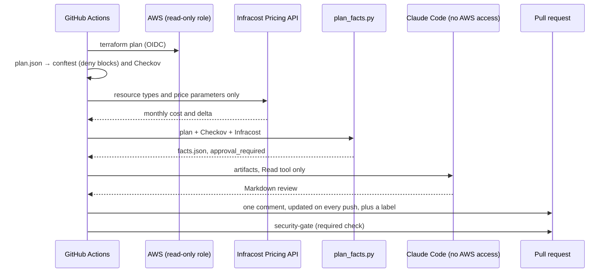

> Series "Golden pipeline" - Each POC represents my vision of a modern enterprise platform, exploring a different platform engineering decision: what to standardise, what to automate, what to delegate to managed services, and where teams should retain control.

# POC: Amazon ECS on AWS Fargate with Terraform

A public NGINX service with HTTPS, task autoscaling, Fargate Spot and
**ECS-native blue/green deployments** on **Amazon ECS with AWS Fargate**, delivered by a
**pipeline with policy checks, an AI plan review and a security approval gate**.

The question behind this POC: **do you need Kubernetes at all?** The series moves along one axis,
*how much platform you operate yourself*:

1. [poc-aws-eks-karpenter](https://github.com/ailves2009/poc-aws-eks-karpenter): self-managed EKS. You install and operate Karpenter, the AWS Load Balancer Controller and IRSA.
2. [poc-aws-eks-auto](https://github.com/ailves2009/poc-aws-eks-auto): EKS Auto Mode. AWS runs Karpenter, load balancing and Pod Identity inside the cluster.
3. **poc-fargate (this POC)**: no cluster to operate. Every task runs in its own AWS-managed micro-VM.

| Concern                 | Self-managed (karpenter POC)                      | EKS Auto Mode (auto POC)                                 | **ECS Fargate (this POC)**                                              |
| ----------------------- | ------------------------------------------------- | -------------------------------------------------------- | ----------------------------------------------------------------------- |
| Node provisioning       | Karpenter Helm chart, IAM, SQS interruption queue | Built in; AWS runs Karpenter in the control plane        | **No nodes.** Each task gets its own isolated compute                   |
| Node OS / patching      | Your AMI choice, your upgrade cadence             | Bottlerocket, replaced at most every 21 days             | AWS patches the Fargate platform and replaces tasks on retired revisions |
| Load balancers          | AWS Load Balancer Controller (Helm + IRSA)        | Built in (`eks.amazonaws.com/alb` IngressClass)          | ALB in Terraform; ECS registers task IPs in target groups               |
| Cluster add-ons         | EKS add-ons you version and upgrade               | Built in and upgraded by AWS                             | None. There is no Kubernetes                                            |
| Workload IAM            | IRSA (OIDC provider)                              | EKS Pod Identity                                         | ECS task role per service                                               |
| Workload autoscaling    | HPA + metrics-server                              | HPA v2 + metrics-server EKS community add-on             | Application Auto Scaling, target tracking on CPU                        |
| Deployments             | Argo CD (GitOps), rolling updates                 | Kubernetes rolling updates, PDB                          | **ECS-native blue/green** with a smoke-test hook, alarm and auto-rollback |
| Spot                    | Spot-first NodePool, On-Demand fallback           | Spot-first `apps` NodePool, On-Demand fallback           | `FARGATE_SPOT` capacity provider                                        |
| Customisation           | Full control of controllers and node AMIs         | `NodePool` / `NodeClass` / `IngressClassParams` CRDs     | Task definition only: no DaemonSets, no privileged containers, no GPUs   |
| Cost                    | EC2 only                                          | EC2 plus a per-instance Auto Mode management fee         | Per task vCPU and GB per second; Fargate Spot up to 70% cheaper         |

## The decision in one page

| Point of view | On one hand                                                                 | On the other hand                                                                    |
| ------------- | --------------------------------------------------------------------------- | ------------------------------------------------------------------------------------ |
| **Business**  | A small team ships a service without a platform team or Kubernetes skills  | Lock-in to ECS APIs; moving to Kubernetes later means rewriting deployment manifests |
| **Operations**| No nodes, no cluster upgrades, no add-ons: the cheapest platform to *run*  | Less control: no DaemonSets, no host access, no GPUs, fewer ecosystem tools           |
| **Security**  | Each task in its own micro-VM; no shared kernel, no node to break into     | The perimeter moves to IAM, the ALB and the pipeline: they must be right             |
| **Cost**      | Pay per task-second, nothing idle; Spot for interruption-tolerant capacity  | At steady high utilisation EC2 (Karpenter) is cheaper per vCPU                         |
| **Reliability** | AWS SLA 99.99% for ECS/Fargate and the ALB; blue/green with auto-rollback | Most outages come from changes, not from AWS: the pipeline is the reliability tool   |

**Rule of thumb:** Fargate for teams with fewer than ~20 services, spiky or low load, and no
Kubernetes-specific needs. EKS once you need the Kubernetes ecosystem, many teams on one
platform, or high steady utilisation.

## What gets deployed



| File                     | What it does                                                                                              |
| ------------------------ | --------------------------------------------------------------------------------------------------------- |
| `vpc.tf`                 | VPC with the same layout as the EKS POCs: 3 AZs, /20 private and /24 public subnets, one NAT, flow logs |
| `main.tf`                | ECS cluster and both services, ALB with blue/green target groups and listener rules, Route53 record, IAM  |
| `deploy-gates.tf`        | Blue/green gates: smoke-test Lambda hook, the role ECS uses to call it, the 5xx rollback alarm            |
| `acm.tf`                 | ACM certificate for exactly one hostname, validated in the DNS account                                     |
| `firehose.tf`            | Kinesis Firehose delivery stream to an S3 bucket, with delivery-error logging                             |
| `providers.tf`           | Providers pinned to accounts (`allowed_account_ids`), `aws.dns` for the DNS account, S3 backend with `use_lockfile` |
| `lambda/smoke_test/`     | The hook: N requests through the test rule, verdict by status code and latency                            |
| `.github/workflows/`     | The pipeline (see below)                                                                                   |
| `policy/terraform.rego`  | Conftest guardrails on the plan: the findings of this POC's own security review, as code                  |
| `ci/plan_facts.py`       | Deterministic facts from the plan: changes, blast radius, IAM/SG changes, cost, *security approval needed?* |
| `ci/ai-review-prompt.md` | Prompt of the AI plan reviewer                                                                             |

The POC creates its own VPC with the same layout as the EKS POCs of the series (`10.1.0.0/16`
instead of `10.0.0.0/16`, so they can be peered later). The Route53 hosted zone is an **input**.

## How the requirements are met

**Serverless compute.** There are no EC2 instances, AMIs or node groups. Each task runs
on Fargate with its own kernel, so tasks never share a host with other workloads.

**Spot with an On-Demand baseline.** Both services use
`FARGATE base = 1, weight = 1` + `FARGATE_SPOT weight = 1`: the first task is always
On-Demand, and the rest are split 1:1 with Spot. The strategy is set **on each service**.
A service without its own strategy gets `launch_type = FARGATE` and ignores the cluster
default, so it never runs on Spot.

**Task autoscaling.** Application Auto Scaling target tracking on average CPU (70%),
from `desired_count` (2) to `autoscaling_max_capacity` (10). Scale-out cooldown is 60 s,
scale-in cooldown 300 s. This is the ECS counterpart of HPA v2 in the EKS POCs.

**Blue/green deployments (ECS-native).** The nginx service has two identical target
groups, `blue-tg` and `green-tg`. On every new task definition revision:

1. ECS starts the new revision in the idle target group.
2. The **test listener rule** (`X-Blue-Green: test` header) sends test traffic to it; production stays on the current revision.
3. **Gate 1, smoke test.** In the `POST_TEST_TRAFFIC_SHIFT` lifecycle stage ECS calls a Lambda. It sends 10 requests through the test rule and returns `FAILED` on any non-200 or slow response. ECS then rolls back before a single user request reaches the new revision.
4. ECS shifts the **production listener rule** to the new target group.
5. **Gate 2, alarm.** During the bake time (`blue_green_bake_time_minutes`, 5) the old tasks keep running. If the target 5xx alarm fires, ECS switches production back to them in seconds.
6. After the bake time the old tasks stop. The target groups have now swapped roles.

ECS rewrites the listener rule weights during each deployment. That is why the two rules
are standalone `aws_lb_listener_rule` resources with `ignore_changes = [action]`. If Terraform
owned the weights, the next `apply` would point production back at an empty target group.

**Public access.** The ALB redirects HTTP to HTTPS and accepts TLS 1.2/1.3 only
(`ELBSecurityPolicy-TLS13-1-2-2021-06`). The certificate covers exactly
`poc-fargate.<domain>`, not a wildcard. The zone lives in a separate DNS account (a common
multi-account layout); the `aws.dns` provider writes the alias and validation records there.

**Log shipping.** The internal sample app (`poc-ecs-service`) writes to stdout. A
**FireLens** Fluent Bit sidecar ships those logs to Kinesis Firehose, which delivers them
gzip-compressed to S3. ECS generates the Fluent Bit configuration from the app container's
`logConfiguration`, so no config file is needed. nginx logs go straight to CloudWatch Logs.

## The pipeline



- **No long-lived keys.** GitHub OIDC → a read-only role for PR plans, a separate apply role for `master`.
- **Policies as code.** `policy/terraform.rego` blocks a PR on `Action "*"`, ports other than 80/443 open to the internet, a non-TLS13 listener policy, images without a digest and privileged containers. Every rule is a finding from this POC's own review, so the same mistakes cannot come back.
- **Security approval is a deterministic decision.** `ci/plan_facts.py` requires it for changes to IAM, security groups, listeners/TLS, DNS, KMS or bucket policies; for policy findings; and for deleting or replacing stateful resources. The `security-gate` check passes only after someone from `SECURITY_REVIEWERS` (not the PR author) adds the `security-approved` label.
- **Apply runs exactly the reviewed plan** behind a manual approval (GitHub environment `production`).

### How a plan is reviewed



- **Infracost** is an open-source CLI that prices a Terraform plan before `apply`. It maps each resource (Fargate vCPU/GB-hours, ALB, NAT, Lambda, logs) to AWS list prices and reports the monthly cost and the delta of the PR. Usage-based items (traffic, log volume) need a usage file; Fargate Spot is priced as On-Demand, so the real bill is lower.
- **`ci/plan_facts.py`** turns the plan into facts: create/update/replace/delete, blast radius (stateful losses, user-facing changes), IAM and network changes with content checks, cost, and the **security approval decision with its reasons**. It never fails the build: conftest blocks, the security gate enforces.
- **The AI review** runs in a job without AWS credentials or write access. A separate job posts it as a single PR comment (found by a hidden marker and updated in place). If the model is unavailable, nothing blocks: the review is advisory.

## AI in this project

### Implemented: AI plan reviewer

On every PR, Claude Code (`claude -p`, headless) reads the plan JSON, the Checkov and conftest
results, the Infracost estimate and the facts file. It posts one comment:

- what changes, and every replacement or deletion with its consequence;
- **blast radius**: what users would notice, and whether the blue/green rollback covers it (it never covers ALB, DNS, IAM or S3);
- **IAM and network changes** in plain words: who gets which permission on what;
- **security approval**: the deterministic decision with its reasons. The model explains it but cannot change it;
- **monthly cost delta.**

Most findings of the manual security review of this POC (wildcard IAM, SSH open to the
world, legacy TLS, unpinned images) would have been caught on the first PR.

**How the reviewer itself is secured** (agent security is part of the design, not an afterthought):

| Risk                                      | Control                                                                                         |
| ----------------------------------------- | ----------------------------------------------------------------------------------------------- |
| The agent changes infrastructure          | The AI job has **no AWS credentials** and only `contents: read`; its only tool is `Read`         |
| Prompt injection through the change under review (resource names, tags, descriptions) | The prompt treats all file content as data; the model's output is only a comment; no decision depends on it |
| The model "approves" a risky change       | Approval is computed by `plan_facts.py` and enforced by `security-gate`; the model can only explain |
| Secret leakage                            | The model sees the plan JSON, never `inputs.tfvars`; the API key is a GitHub secret              |
| Supply chain                              | The Claude Code CLI and every GitHub Action are pinned (version or commit SHA)                  |

### Roadmap: agents (not in this POC)

The principle stays the same: **an agent advises and explains, a deterministic pipeline acts.**

| Agent | What it does | Why it is still an agent, not a script |
| ----- | ------------ | -------------------------------------- |
| **Deployment gate, second key** | A second hook in `POST_TEST_TRAFFIC_SHIFT`: a Lambda collects metrics and logs of the green revision and asks a model for a structured `proceed` / `rollback` verdict with reasons | Reads unstructured logs; the alarm and smoke test stay the primary criteria |
| **Incident analyst** | Athena over the FireLens → Firehose → S3 logs, plus MCP tools (AWS Labs MCP for ECS, CloudWatch, Terraform). Answers "why did 5xx grow after the deploy?" in Slack | Chooses which tools and queries to run |
| **Drift and cost** | A nightly `terraform plan -detailed-exitcode`; on drift the agent explains it and opens a PR or an issue | Writes the explanation and the fix proposal |
| **Compliance evidence** | Checks the live account and the code against controls used in real fintech audits (DORA, ISO 27001 Annex A, SOC 2 Security): backups, encryption, log retention, access reviews. Produces an evidence pack with gaps | Maps findings to control wording; a human signs off |
| **Golden path as a skill** | A Claude Code skill `new-service`: a team asks "a public service with blue/green" and gets a service generated by the series standards. The same pipeline policies then check the result | The skill encodes *how we build*; the policies prove it was followed |
| **Series benchmark** | The same load test on all POCs of the series; a report on scale-out time, cost per 1M requests and manual effort | Compares and writes the report |

**Golden path as a skill, in more detail.** A platform team usually publishes a template
(cookiecutter, Backstage). A Claude Code skill is a template that can talk: a `SKILL.md` with the
series standards (digests, TLS13, task roles, blue/green gates, tags) plus reference files. A
developer describes the service, and the skill produces the Terraform and the PR. Generation is
not trusted: the result goes through the same conftest rules and security gate as handwritten
code. The standards live in one place, and both people and agents follow them.

## Reliability in nines

| Layer                         | AWS SLA (monthly)  | What it means here                                    |
| ----------------------------- | ------------------ | ----------------------------------------------------- |
| Route 53                      | 100%               | DNS is not the weak link                              |
| ALB                           | 99.99%             | Multi-AZ by design                                     |
| ECS / Fargate (multi-AZ)      | 99.99%             | Tasks spread over 2–3 AZs, `desired_count = 2`        |
| **Composite, infrastructure** | **≈ 99.98%**       | ≈ 9 min of downtime per month as an upper bound from AWS |

The infrastructure is not the limiting factor. **Changes are**, so the design spends its effort there:

- blue/green with a smoke-test gate and an alarm rollback: a bad release is stopped before or within a minute of real traffic;
- an On-Demand base task: Spot interruptions never take the service to zero;
- autoscaling from 2 tasks across AZs.

A realistic SLO for this single-region design is **99.9%** (43 min error budget per month).
**99.95%** needs latency/5xx SLO alarms and a tested runbook. **99.99%** needs a second region
(Route 53 failover, replicated data) and is a business decision, not a Terraform setting.

## Security

> **In this POC the focus is on the workload itself**: an isolated runtime, least-privilege
> identities, a hardened container and a pipeline that does not let these regress. **In
> production the focus widens to the whole system**: data at rest and in transit, the network
> perimeter, monitoring and detection, and cost control.

### ✅ Implemented

- **Wrong-account guard.** `allowed_account_ids` pins both providers to their accounts. Real IDs live only in the gitignored `inputs.tfvars` and `backend.hcl`.
- **Remote state.** S3 backend with native locking (`use_lockfile = true`, no DynamoDB). The bucket is versioned, SSE-KMS encrypted, has Block Public Access on and a TLS-only bucket policy.
- **TLS 1.2/1.3 only** on the HTTPS listener, an HTTP → HTTPS redirect, and a certificate for one hostname only.
- **Scoped IAM.**
  - The module's `"*"` execution policy is replaced by one limited to this project's log groups and this account's ECR.
  - The task role can write only to its own Firehose stream and the ECS Exec audit log group.
  - The deployment hook role can invoke exactly one Lambda; that Lambda has no AWS API permissions at all.
- **Hardened nginx**, the same baseline as Pod Security `restricted` in the EKS POCs:
  - unprivileged image, UID 101;
  - read-only root filesystem with a task-local `/tmp`;
  - all Linux capabilities dropped.
- **Audited ECS Exec.** Every interactive session is logged to `/aws/ecs/ecs-integrated/exec`.
- **Pinned supply chain.** Images are pinned by digest (enforced by variable validation and conftest), Terraform modules by version, GitHub Actions by commit SHA.
- **Safe deployments.** Smoke-test hook and 5xx alarm as rollback triggers.
- **Pipeline guardrails.** OIDC, policies as code, security approval gate, manual production approval.
- **Minimal network exposure.** Tasks run in private subnets without public IPs; nginx accepts traffic only from the ALB security group; the sample app has no ingress at all. VPC flow logs go to CloudWatch (30 days).

Known exceptions in this POC:
- `poc-ecs-app` (the AWS `ecsdemo-frontend` sample) writes to its root filesystem and runs as root, so it is not hardened. Replace it with your own image to apply the same settings as nginx. The pipeline reports it as a warning on every plan.
- The FireLens log router (`aws-for-fluent-bit`) runs with the settings AWS provides.

### ⚠️ Not done in this POC — required in production

These are left out on purpose to keep the POC small and cheap.
**Do them before you run anything real on this design.**

| Area | What production needs |
|------|----------------------|
| Log bucket (S3) | No `force_destroy`; SSE-KMS with a customer-managed key; lifecycle rules; a bucket policy denying non-TLS access; versioning / Object Lock if the logs are audit evidence |
| Kinesis Firehose | Server-side encryption (SSE with KMS) on the delivery stream |
| ALB | AWS WAF web ACL (AWS managed rule groups, rate limiting); access logs to S3; deletion protection |
| Network | One NAT per AZ (a single NAT is a single point of failure for egress); replace `0.0.0.0/0` egress with specific destinations; VPC endpoints (ECR API/DKR, S3 gateway, CloudWatch Logs, Firehose, SSM messages) |
| ECS Exec | KMS-encrypt exec sessions; allow `ecs:ExecuteCommand` only to a break-glass role |
| Detection | CloudTrail (organisation trail), GuardDuty with ECS Runtime Monitoring, Security Hub, AWS Config |
| Deployments | Latency (p99) alarm next to 5xx; the AI second key in the deployment hook |
| Cost | AWS Budgets and anomaly detection per project tag; Infracost thresholds that block a PR |
| CI roles | The GitHub OIDC provider and the plan/apply roles as code, with a permission boundary |

## Deploy

Prerequisites:
- Terraform ≥ 1.10 and AWS CLI v2;
- a public Route53 hosted zone, in this or in a separate DNS account;
- an S3 bucket for the state (versioned, encrypted).

Use short-lived credentials (IAM Identity Center / SSO) wherever possible:

```bash
aws sso login --profile <your_profile>
export AWS_PROFILE=<your_profile>
```

Copy the examples and fill in your values. `inputs.tfvars` and `backend.hcl` are gitignored, so
real account IDs, VPC, subnet and hosted zone IDs never reach git:

```bash
cp inputs.tfvars.example inputs.tfvars   # account_id, domain, zone, dns_* if needed
cp backend.hcl.example   backend.hcl     # state bucket and region

terraform init -backend-config=backend.hcl
terraform plan  -var-file=inputs.tfvars
terraform apply -var-file=inputs.tfvars
```

> **Wrong-account guard.** If your current AWS profile points to a different account
> than `account_id`, `plan` fails before anything is created.
>
> **Pinned images.** Every image variable must be `<repo>@sha256:<digest>`. Mutable tags
> like `:latest` or `:stable` are rejected. To resolve a digest: `crane digest <image>:<tag>`.

## Verify

```bash
terraform output alb_full_dns_name
curl -I https://poc-fargate.ailves2009.com      # HTTP/2 200
curl -I http://poc-fargate.ailves2009.com       # 301 -> https

aws ecs describe-services --cluster ecs-integrated \
  --services poc-ecs-service-rc --query 'services[0].capacityProviderStrategy'
aws ecs list-tasks --cluster ecs-integrated --service-name poc-ecs-service-rc
aws logs tail /aws/ecs/poc-ecs-service-rc/nginx --follow
```

Run a blue/green deployment by changing `nginx_image` to another digest and running
`terraform apply`, then watch it:

```bash
aws ecs describe-services --cluster ecs-integrated --services poc-ecs-service-rc \
  --query 'services[0].deployments[].{status:status,rollout:rolloutState,running:runningCount}'

# while the new revision is in the test stage:
curl -H 'X-Blue-Green: test' https://poc-fargate.ailves2009.com/

# the gate's verdict:
aws logs tail /aws/lambda/poc-fargate-bg-smoke-test
```

To see a rollback, deploy an image that returns 500 on `/` (or set `smoke_test_path` to a
path that does not exist): the hook returns `FAILED`, and production never moves.

Logs from the sample app arrive in S3 through Firehose (with a buffering delay of up to a few minutes):

```bash
aws s3 ls s3://$(aws firehose describe-delivery-stream --delivery-stream-name poc-fargate-firehose-stream \
  --query 'DeliveryStreamDescription.Destinations[0].ExtendedS3DestinationDescription.BucketARN' \
  --output text | cut -d: -f6)/ --recursive | tail
```

Open a shell in a task (the session is recorded in `/aws/ecs/ecs-integrated/exec`):

```bash
aws ecs execute-command --cluster ecs-integrated --task <task-id> \
  --container poc-ecs-app --interactive --command "/bin/sh"
```

## Destroy

```bash
terraform destroy -var-file=inputs.tfvars
```

This deletes everything this configuration created, including the log bucket (it has
`force_destroy` in this POC). The state bucket is created outside Terraform and stays.

## Trade-offs

- **No cluster to run.** You don't upgrade Kubernetes, add-ons or nodes. In exchange you get no DaemonSets, no privileged containers, no GPUs, and less control over the host.
- **Cost.** Fargate charges per task-second for vCPU and memory. At steady high utilisation, EC2 (or EKS with Karpenter) is usually cheaper. Fargate Spot reduces the gap for interruption-tolerant tasks.
- **Blue/green protects the service, not the platform.** A bad change to the ALB, DNS or IAM is not rolled back by ECS. That is why the pipeline treats those changes as security-relevant and the AI review calls them out.
- **Observability.** Next: CloudWatch Container Insights, p99 latency SLO alarms, X-Ray / ADOT tracing.

---

License: MIT (see [LICENSE](LICENSE)).

This project uses the following open-source modules, both licensed under Apache License 2.0:

- [terraform-aws-modules/ecs/aws](https://github.com/terraform-aws-modules/terraform-aws-ecs)
- [terraform-aws-modules/alb/aws](https://github.com/terraform-aws-modules/terraform-aws-alb)
