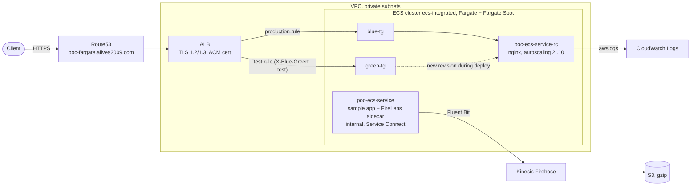

> Series "Golden pipeline" - Each POC represents my vision of a modern enterprise platform, exploring a different platform engineering decision: what to standardise, what to automate, what to delegate to managed services, and where teams should retain control.

# POC: Amazon ECS on AWS Fargate with Terraform

A public NGINX service with HTTPS, task autoscaling, Fargate Spot and
**ECS-native blue/green deployments** on **Amazon ECS with AWS Fargate**, built with Terraform.

This POC is the far end of the series: **no Kubernetes and no nodes at all**.
The companion projects run the same kind of NGINX + HTTPS + autoscaling platform on EKS:

- [poc-aws-eks-karpenter](https://github.com/ailves2009/poc-aws-eks-karpenter): self-managed EKS. You install and operate Karpenter, the AWS Load Balancer Controller and IRSA.
- [poc-aws-eks-auto](https://github.com/ailves2009/poc-aws-eks-auto): EKS Auto Mode. AWS runs Karpenter, load balancing and Pod Identity inside the cluster.
- **poc-fargate (this POC)**: no cluster to operate. Every task runs in its own AWS-managed micro-VM.

| Concern                 | Self-managed (karpenter POC)                      | EKS Auto Mode (auto POC)                                 | **ECS Fargate (this POC)**                                              |
| ----------------------- | ------------------------------------------------- | -------------------------------------------------------- | ----------------------------------------------------------------------- |
| Node provisioning       | Karpenter Helm chart, IAM, SQS interruption queue | Built in; AWS runs Karpenter in the control plane        | **No nodes.** Each task gets its own isolated compute                   |
| Node OS / patching      | Your AMI choice, your upgrade cadence             | Bottlerocket, replaced at most every 21 days             | AWS patches the Fargate platform and replaces tasks on retired revisions |
| Load balancers          | AWS Load Balancer Controller (Helm + IRSA)        | Built in (`eks.amazonaws.com/alb` IngressClass)          | ALB in Terraform; ECS registers task IPs in target groups               |
| Cluster add-ons         | EKS add-ons you version and upgrade               | Built in and upgraded by AWS                             | None. There is no Kubernetes                                            |
| Workload IAM            | IRSA (OIDC provider)                              | EKS Pod Identity                                         | ECS task role per service                                               |
| Workload autoscaling    | HPA v2                                            | HPA v2                                                   | Application Auto Scaling, target tracking on CPU                        |
| Deployments             | Kubernetes rolling update / Argo CD               | Kubernetes rolling update                                | **ECS-native blue/green** with test traffic, bake time and auto-rollback |
| Spot                    | Karpenter NodePool (`capacity-type`)              | NodePool (`capacity-type`)                               | `FARGATE_SPOT` capacity provider                                        |
| Customisation           | Full control of controllers and node AMIs         | `NodePool` / `NodeClass` / `IngressClassParams` CRDs     | Task definition only: no DaemonSets, no privileged containers, no GPUs   |
| Cost                    | EC2 only                                          | EC2 plus a per-instance Auto Mode management fee         | Per task vCPU and GB per second; Fargate Spot up to 70% cheaper         |

## What gets deployed



| File          | What it does                                                                                                 |
| ------------- | ------------------------------------------------------------------------------------------------------------ |
| `main.tf`     | ECS cluster and both services, ALB with blue/green target groups and listener rules, Route53 record, IAM     |
| `acm.tf`      | Wildcard ACM certificate with DNS validation (or an existing certificate ARN)                                 |
| `firehose.tf` | Kinesis Firehose delivery stream to an S3 bucket, with delivery-error logging                                |
| `providers.tf`| AWS provider pinned to one account (`allowed_account_ids`), default tags                                     |
| `variables.tf`, `outputs.tf`, `inputs.tfvars.example` | Inputs (images must be pinned by digest), outputs, and a template for your values    |

The VPC, subnets and the Route53 hosted zone are **inputs**: this POC deploys into an existing network.

## How the requirements are met

**Serverless compute.** There are no EC2 instances, AMIs or node groups. Each task runs
on Fargate with its own kernel, so tasks never share a host with other workloads.

**Spot with an On-Demand baseline.** Both services use
`FARGATE base = 1, weight = 1` + `FARGATE_SPOT weight = 1`: the first task is always
On-Demand, and the rest are split 1:1 with Spot. The strategy is set **on each service**.
A service without its own strategy gets `launch_type = FARGATE` and ignores the cluster
default, so it never runs on Spot.

**Task autoscaling.** Application Auto Scaling target tracking on average CPU (70%),
from `desired_count` (2) to `autoscaling_max_capacity` (10). Scale-out cooldown is 60 s,
scale-in cooldown 300 s. This is the ECS counterpart of HPA v2 in the EKS POCs.

**Blue/green deployments (ECS-native).** The nginx service has two identical target
groups, `blue-tg` and `green-tg`. On every new task definition revision:

1. ECS starts the new revision in the idle target group.
2. The **test listener rule** (`X-Blue-Green: test` header) sends test traffic to it, while production traffic stays on the current revision.
3. ECS shifts the **production listener rule** to the new target group.
4. The old tasks stay running for `blue_green_bake_time_minutes` (5). A failed deployment (circuit breaker) rolls back instantly.
5. After the bake time the old tasks stop. The target groups have now swapped roles.

ECS rewrites the listener rule weights during each deployment. That is why the two rules
are standalone `aws_lb_listener_rule` resources with `ignore_changes = [action]`. If Terraform
owned the weights, the next `apply` would point production back at an empty target group.

**Public access.** The ALB redirects HTTP to HTTPS and accepts TLS 1.2/1.3 only
(`ELBSecurityPolicy-TLS13-1-2-2021-06`). Route53 has an alias record for the service.

**Log shipping.** The internal sample app (`poc-ecs-service`) writes to stdout. A
**FireLens** Fluent Bit sidecar ships those logs to Kinesis Firehose, which delivers them
gzip-compressed to S3. ECS generates the Fluent Bit configuration from the app container's
`logConfiguration`, so no config file is needed. nginx logs go straight to CloudWatch Logs.

## Security

### ✅ Implemented

- **Wrong-account guard.** `allowed_account_ids` pins the provider to `var.account_id`. The real ID lives only in the gitignored `inputs.tfvars`.
- **TLS 1.2/1.3 only** on the HTTPS listener, plus an HTTP → HTTPS redirect.
- **Scoped IAM.**
  - The module's `"*"` execution policy is replaced by one limited to this project's log groups and this account's ECR.
  - The task role can write only to its own Firehose stream and the ECS Exec audit log group.
- **Hardened nginx**, the same baseline as Pod Security `restricted` in the EKS POCs:
  - unprivileged image, UID 101;
  - read-only root filesystem with a task-local `/tmp`;
  - all Linux capabilities dropped.
- **Audited ECS Exec.** Every interactive session is logged to `/aws/ecs/ecs-integrated/exec`.
- **Pinned supply chain.** Images are pinned by digest (enforced by variable validation), and Terraform modules are pinned by version.
- **Minimal network exposure.**
  - Tasks run in private subnets with no public IPs.
  - nginx accepts traffic only from the ALB security group.
  - The sample app has no ingress at all.

Known exceptions in this POC:
- `poc-ecs-app` (the AWS `ecsdemo-frontend` sample) writes to its root filesystem and runs as root, so it is not hardened. Replace it with your own image to apply the same settings as nginx.
- The FireLens log router (`aws-for-fluent-bit`) runs with the settings AWS provides.

### ⚠️ Not done in this POC — required in production

These are left out on purpose to keep the POC small and cheap.
**Do them before you run anything real on this design.**

| Area | What production needs |
|------|----------------------|
| Log bucket (S3) | No `force_destroy`; SSE-KMS with a customer-managed key; lifecycle rules (transition/expiration); a bucket policy denying non-TLS access (`aws:SecureTransport = false`); versioning / Object Lock if the logs are audit evidence |
| Kinesis Firehose | Server-side encryption (SSE with KMS) on the delivery stream |
| ALB | AWS WAF web ACL (AWS managed rule groups, rate limiting); access logs to S3; deletion protection |
| Task egress | Replace `0.0.0.0/0` egress with specific destinations; add VPC endpoints (ECR API/DKR, S3 gateway, CloudWatch Logs, Firehose, SSM messages) so tasks reach AWS APIs without the NAT gateway |
| ECS Exec | KMS-encrypt exec sessions; allow `ecs:ExecuteCommand` only to a break-glass role |
| State | Remote S3 backend with native lockfile (`use_lockfile = true`), versioned and KMS-encrypted |
| Deployments | CloudWatch alarms (5xx, latency) as deployment rollback triggers; lifecycle hooks (Lambda) running smoke tests against the test listener rule |

## Deploy

Prerequisites:
- Terraform ≥ 1.10 and AWS CLI v2;
- an existing VPC with public and private subnets, and a NAT for task egress;
- a public Route53 hosted zone.

Use short-lived credentials (IAM Identity Center / SSO), not long-lived access keys:

```bash
aws sso login --profile <your_profile>
export AWS_PROFILE=<your_profile>
```

Copy the example and fill in your values. `inputs.tfvars` is gitignored, so the real
account ID, VPC, subnet and hosted zone IDs never reach git:

```bash
cp inputs.tfvars.example inputs.tfvars
# set account_id, domain_name, hosted_zone_id, vpc_id, subnets

terraform init
terraform plan  -var-file=inputs.tfvars
terraform apply -var-file=inputs.tfvars
```

> **Wrong-account guard.** If your current AWS profile points to a different account
> than `account_id`, `plan` fails before anything is created.
>
> **Pinned images.** Every image variable must be `<repo>@sha256:<digest>`. Mutable tags
> like `:latest` or `:stable` are rejected. To resolve a digest: `crane digest <image>:<tag>`.

## Verify

```bash
terraform output alb_full_dns_name
curl -I https://poc-fargate.ailves2009.com      # HTTP/2 200
curl -I http://poc-fargate.ailves2009.com       # 301 -> https

aws ecs describe-services --cluster ecs-integrated \
  --services poc-ecs-service-rc --query 'services[0].capacityProviderStrategy'
aws ecs list-tasks --cluster ecs-integrated --service-name poc-ecs-service-rc
aws logs tail /aws/ecs/poc-ecs-service-rc/nginx --follow
```

Run a blue/green deployment by changing `nginx_image` to another digest and running
`terraform apply`, then watch it:

```bash
aws ecs describe-services --cluster ecs-integrated --services poc-ecs-service-rc \
  --query 'services[0].deployments[].{status:status,rollout:rolloutState,running:runningCount}'

# while the new revision is in the test stage:
curl -H 'X-Blue-Green: test' https://poc-fargate.ailves2009.com/
```

Logs from the sample app arrive in S3 through Firehose (with a buffering delay of up to a few minutes):

```bash
aws s3 ls s3://$(aws firehose describe-delivery-stream --delivery-stream-name poc-fargate-firehose-stream \
  --query 'DeliveryStreamDescription.Destinations[0].ExtendedS3DestinationDescription.BucketARN' \
  --output text | cut -d: -f6)/ --recursive | tail
```

Open a shell in a task (the session is recorded in `/aws/ecs/ecs-integrated/exec`):

```bash
aws ecs execute-command --cluster ecs-integrated --task <task-id> \
  --container poc-ecs-app --interactive --command "/bin/sh"
```

## Destroy

```bash
terraform destroy -var-file=inputs.tfvars
```

This deletes the ECS cluster and services, the ALB and target groups, the Firehose stream,
the log bucket (it has `force_destroy` in this POC), the log groups and the IAM roles and policies.

## Trade-offs and next steps

- **No cluster to run.** You don't upgrade Kubernetes, add-ons or nodes. In exchange you get no DaemonSets, no privileged containers, no GPUs, and less control over the host.
- **Cost.** Fargate charges per task-second for vCPU and memory. At steady high utilisation, EC2 (or EKS with Karpenter) is usually cheaper. Fargate Spot reduces the gap for interruption-tolerant tasks.
- **CI/CD.** Next step for the series: a pipeline with GitHub Actions / GitLab OIDC federation (no long-lived keys), plan review, policy checks, and blue/green deployments triggered by a new image digest.
- **Observability.** CloudWatch Container Insights, alarms as rollback triggers, X-Ray / ADOT for tracing.

---

License: MIT (see [LICENSE](LICENSE)).

This project uses the following open-source modules, both licensed under Apache License 2.0:

- [terraform-aws-modules/ecs/aws](https://github.com/terraform-aws-modules/terraform-aws-ecs)
- [terraform-aws-modules/alb/aws](https://github.com/terraform-aws-modules/terraform-aws-alb)
